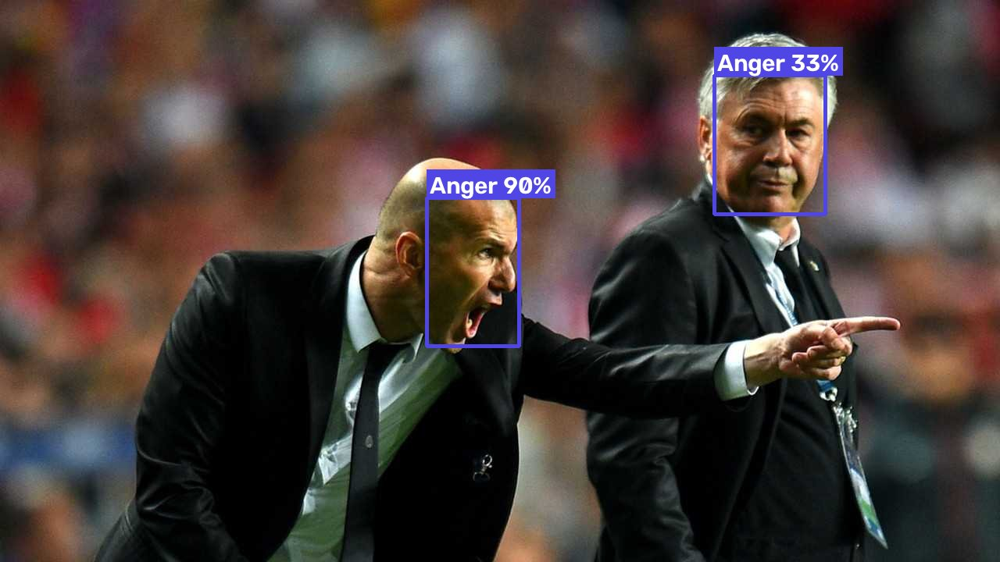

# Face Emotion Detector

Finds every face in a photo or live webcam video and recognises its facial expression (8 emotions), entirely in the browser.

**[Live demo →](LIVE_DEMO_URL)** — start your webcam, upload a photo or pick a sample image. Both neural networks run locally with ONNX Runtime Web: nothing is uploaded.



## Results

There is no training in this project: it chains two pretrained models (a face detector and an emotion classifier) and ships them to the browser. The work is in the pipeline, the speed trade-off and making the JavaScript version match Python exactly.

**Browser pipeline vs. the original Python pipeline** (ultralytics + hsemotion_onnx), 3 sample images, 320 px input:

| Check | Result |
|---|---|
| Reference faces found by the browser logic | **10 / 10** (5 faces × 2 references) |
| Same emotion label | **10 / 10** |
| Lowest box IoU | 0.970 vs PyTorch model, 0.999 vs the ONNX export |
| Largest emotion-probability difference | 0.005 |
| Model download | 14.4 MB (6.3 MB detector + 8.1 MB emotion model) |

**Speed, 640 vs 320 px input** (zidane.jpg, laptop CPU — Intel i3-10110U, median of 10 runs, detection + emotion for each face):

| Pipeline | 640 px | 320 px |
|---|---|---|
| ultralytics (PyTorch) + HSEmotion | 226 ms (4.4 FPS) | **120 ms (8.3 FPS)** |
| ONNX Runtime, browser logic in NumPy | 282 ms (3.5 FPS) | 186 ms (5.4 FPS) |

Both sizes find the same 2 faces on this image. Timings were measured on a shared, busy machine, so treat them as relative, not absolute.

Sample predictions: astronaut → Happiness (100%), Zidane shouting → Anger (90%), Ancelotti → Anger 33% / Contempt 31% (ambiguous), bus scene → Neutral for both visible faces (the other two people's heads are outside the frame).

## Key findings

- A dedicated **face detector** is needed: COCO-trained YOLO11n finds "person" and "tie", but has no face class.
- Halving the input size from 640 to 320 px roughly **halves the time per frame** on CPU and still finds the main faces — the right trade-off for a webcam where faces are large. For crowd photos with many small faces, 640 px is the safer choice.
- Clear expressions (a big smile, a shout) get confident predictions; subtle ones are split between neighbouring classes such as anger and contempt, so the demo always shows the full score distribution.
- Storing ONNX weights as float16 (cast back to float32 at load time) halves the download with no visible effect on the outputs (max probability difference 0.005).

## Approach

1. **Object detection** — YOLO11n (COCO) on a sample image to show boxes, confidences and classes.
2. **Face detection** — [YOLOv8n-face](https://github.com/akanametov/yolo-face), a YOLOv8 pose model trained on WIDER FACE (1 class + 5 landmarks).
3. **Emotion recognition** — each face crop goes to [HSEmotion](https://github.com/HSE-asavchenko/face-emotion-recognition) `enet_b0_8_best_afew` (EfficientNet-B0, 8 emotions).
4. **Pipeline** — `analyze(frame)`: detect → crop → classify → draw; used on photos, in `webcam.py` and in the benchmark.
5. **Export** — the detector is exported to ONNX at 320×320 (opset 17); both ONNX models get float16 weights.
6. **Browser port** — letterbox resize (cv2 `INTER_LINEAR` semantics, grey 114 padding), YOLO output decoding + NMS (conf 0.25, IoU 0.7), integer face crop, 224×224 resize with ImageNet mean/std (exactly as `hsemotion_onnx` preprocesses) and softmax, all hand-written in JavaScript.
7. **Verification** — `face_pipeline.py` is the same algorithm in NumPy with onnxruntime; `train.py` compares it against ultralytics (PyTorch weights and the ONNX export) + hsemotion_onnx on every sample image.

## Project structure

```
├── notebook.ipynb     # detection → face crop → emotions → pipeline → speed test (with outputs)
├── train.py           # download models, export ONNX, verify browser logic, benchmark, write web/
├── face_pipeline.py   # NumPy twin of web/app.js (letterbox, decode, NMS, emotion preprocessing)
├── webcam.py          # live OpenCV webcam loop (press q to quit)
├── requirements.txt
└── web/               # static demo deployed on Vercel
    ├── index.html, app.js, style.css
    ├── models/        # face_detector.onnx, emotion.onnx (float16 weights)
    ├── samples/       # zidane.jpg, bus.jpg, astronaut.jpg
    ├── meta.json      # verification + benchmark numbers shown on the page
    └── assets/        # annotated results, speed chart
```

## Run locally

```bash
pip install -r requirements.txt
python train.py                         # downloads models, exports ONNX, verifies, writes web/
python webcam.py                        # live webcam demo (OpenCV window)
python -m http.server 8000 -d web       # open http://localhost:8000
```

The webcam mode in the browser needs `localhost` or HTTPS.

## Licenses

| Component | License |
|---|---|
| Ultralytics library (YOLO11n, training/export code) | **AGPL-3.0** |
| YOLOv8n-face weights ([akanametov/yolo-face](https://github.com/akanametov/yolo-face)) — trained with Ultralytics, repo GPL-3.0 | **AGPL-3.0** (Ultralytics terms apply to the model) |
| HSEmotion / hsemotion-onnx, `enet_b0_8_best_afew` | Apache-2.0 (trained on AffectNet + AFEW, which are research datasets with their own non-commercial terms) |
| zidane.jpg, bus.jpg | Ultralytics sample assets (AGPL-3.0 repository) |
| Astronaut (Eileen Collins) | NASA, public domain (bundled with scikit-image) |

Because the shipped face detector falls under AGPL-3.0, this repository and the demo are published as open source; a commercial closed-source product would need an Ultralytics Enterprise license or a differently licensed detector.

## Tech

Python · Ultralytics YOLO · HSEmotion · OpenCV · NumPy · ONNX · ONNX Runtime / ONNX Runtime Web · vanilla JavaScript (Canvas, getUserMedia) · Vercel

**Models:** [YOLOv8n-face](https://github.com/akanametov/yolo-face/releases/download/1.0.0/yolov8n-face.pt) · [HSEmotion enet_b0_8_best_afew](https://github.com/HSE-asavchenko/face-emotion-recognition)
